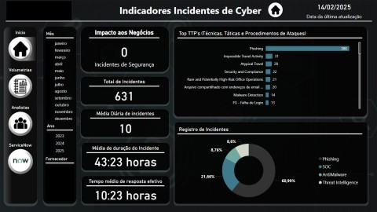
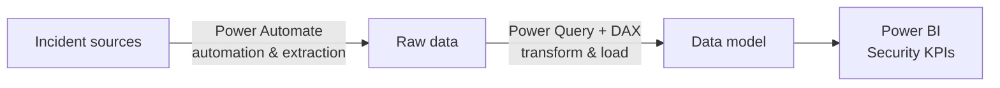
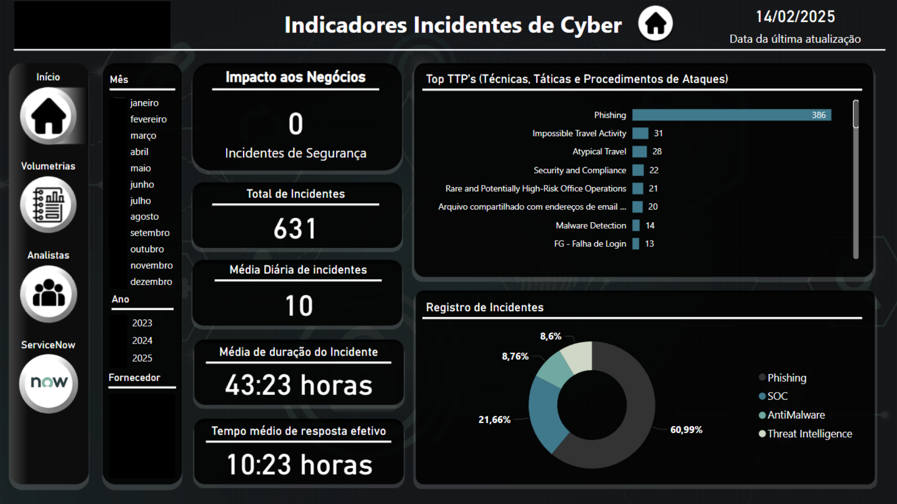
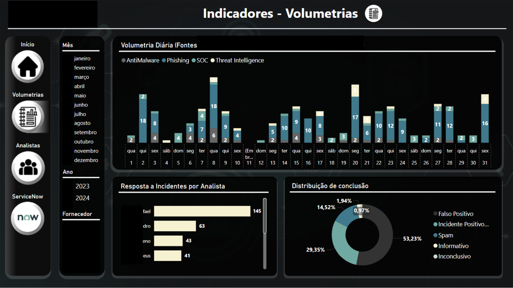

  

  
  
  
  
   
  
  
  

## 🔐 Overview

A **Power BI** report with **indicators and metrics for monitoring Information Security incidents**, giving the security team and leadership a single view of what is happening.

## 🏗️ Pipeline

- **Extraction:** automated with **Power Automate**
- **Transformation & loading:** **Power Query** and **DAX**
- **Output:** incident indicators and metrics for monitoring

## 🎯 The problem

There were **no clear KPIs**, which made it hard to track performance and steer the security strategy with data. The source is an **Excel (.xlsx)** file refreshed in **real time** by **Power Automate** cloud flows.

## 🚀 Results

| | |
|---|---|
| 🎣 **−20%** | people falling for phishing attacks |
| 🔎 **−20%** | mean time to detect an incident |
| ⚡ **−30%** | response time after process gaps were identified |

## 📸 Dashboard gallery

<table>
  <tr>
    <td width="50%" align="center"> <b>Home</b> · Overview, Volumes, Analysts, ServiceNow</td>
    <td width="50%" align="center"> <b>Dashboard page</b></td>
  </tr>
  <tr>
    <td width="50%" align="center"> <b>Dashboard page</b></td>
    <td width="50%" align="center"> <b>Incident indicators</b></td>
  </tr>
</table>

## 🔗 Related

The incident data is also managed through the **[Cyber — IRP app](https://github.com/MatheusFelipePereira/cyber-irp-incident-response)** (Power Apps + Power Automate), which feeds this kind of visualization.

## 👥 Team

Built with César at **Votorantim Cimentos**.

---

🔒 Corporate project: security data is confidential, so this repository documents the solution only.  
👤 Part of <a href="https://github.com/MatheusFelipePereira">Matheus Felipe Pereira's portfolio</a> · <a href="https://www.linkedin.com/in/matheus-felipe-p/">LinkedIn</a>
